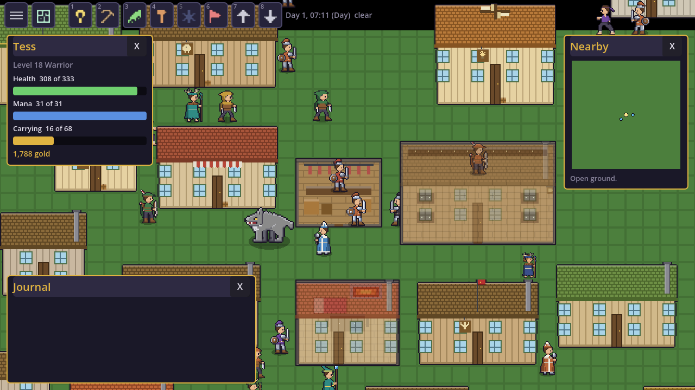
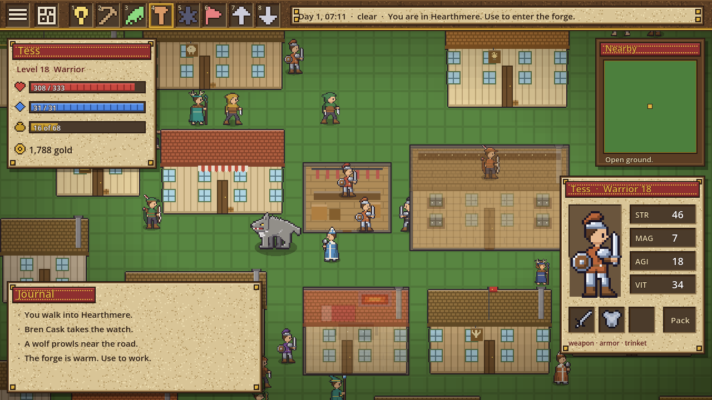

# Art direction: chunky retro, with a rulebook interface

This is the plan for making the game look more modern while staying pixel art. It does not change a rule. `docs/ART_STYLE.md`
still says how a sprite is drawn (outline, colours, size, facing); this says what the whole screen should feel like and in what
order to get there. Steps 1 and 2 below are built for the panes over the open world (see "What is built"); the picture below is the mock-up they follow.

| Now | Mock-up |
|---|---|
|  |  |

The mock-up is drawn by `tools/mockup.gd` (and `tools/mockup_art.gd`) with the real renderer, over the same world at the same
zoom. Run it with:

```bash
xvfb-run -a -s "-screen 0 1280x720x24" godot --path . --rendering-driver opengl3 --audio-driver Dummy -s res://tools/mockup.gd -- out=/tmp/mockup
```

**What it shows:** the interface skin (panels, ribbons, bars, slots, the header, the character sheet), a warm light and a
vignette. **What it does not show:** new world art (the ground, buildings, figures and creatures are the ones the game has now),
a pixel font (it uses the engine's own), or any change of layout (every pane is where it is today).

## Where the look comes from

- **Minecraft: readable and chunky.** Big simple shapes, bright flat colour, and the inventory's inset slots with a dark top-left
  edge and a light bottom-right edge. It is a look that works small, on a phone as well as a monitor.
- **Pathfinder 2E: a rulebook on a table.** Parchment, ink lines, a crimson and gold trim, and a character sheet as the screen
  the player knows best. The game already takes its rules from the tabletop, so its menus can be the book.
- **The Shattered Isles: pixel art with life.** Its store page tags it Pixel Graphics and says it has a paper-style character
  sheet, an animation and an effect for each basic action, and scenery that breaks. The page does not say more about how it looks
  and we have not seen its screenshots, so this is a reference for ambition, not for a particular picture.

## The rules of the look

**One pixel size.** The world and the interface share one pixel: at the default zoom it is 2 screen pixels. Panels are drawn
on that grid and scaled by whole numbers only, with no smoothing (`TEXTURE_FILTER_NEAREST`). A picture with a different pixel
size beside the world is what makes an interface look pasted on.

**The palette.** The sprite palette in `docs/ART_STYLE.md` stays. The interface adds these (ink and gold are the same as the sprites'
outline and accent family):

| Role | Colour |
|---|---|
| Ink (every outline, all text on parchment) | `#2a1c14` |
| Parchment, with `#ecdcb0` light and `#b99f6c` shade | `#d9c597` |
| Wood, with `#74512f` light and `#46301c` shade | `#5a3d24` |
| Gold (studs, selection, the day's trim) | `#e0b341`, shade `#9a6f1c` |
| Crimson (ribbons), light `#b04545`, shade `#5c1c1c` | `#8e2f2f` |
| Inset slot, edge light `#8f7650` | `#4b3b2b` |
| Health, mana, carrying (light, mid, shade) | `#e0605a #c8483f #8e2a28`, `#7fb2ff #4f86e0 #2c5299`, `#e0b341 #c49a2c #8a6a1c` |

**The pieces**
- **Panel:** parchment with a few lighter and darker specks, a one-pixel inner bevel (light top and left, shade bottom and
  right), a brown line and an ink line outside, and a gold stud in each corner. A soft shadow falls down and to the right.
- **Ribbon:** a crimson title strip, lit on top, shaded under, ink outline, gold stitching. Pane titles and section heads.
- **Slot:** an inset square for an item, an action or a stat. Selected or on: a gold frame. Not available: dimmed, not removed.
- **Bar:** an ink frame, a dark track, a segmented fill with a lit top and a shaded bottom. Red, blue and gold keep their jobs.
- **Header:** wooden planks, an ink edge and a gold line. It carries the action slots and the status line.
- **Icons:** action pictures are 8 by 8 and item pictures 12 by 12, each in one colour with a one-pixel ink outline, drawn at whole-number scale.

**Text.** Ink on parchment (9.7 to 1). Light text on a bar or a slot has an ink outline. Labels in dark crimson (7.6 to 1). Gold
on crimson is only 4.1 to 1, so ribbon text is the lighter gold `#f4d37a` (5.6 to 1) or at least 18 pixels. A pixel font is
needed (see the open questions); until then the engine's font is used.

**Light.** One warm key light from the top left, as in the sprites. Night is a cool tint (the day clock already gives it). Fires,
forges and lit windows glow. A soft vignette lowers the corners a little. These are overlays, so they cost nothing in the art.

**Motion.** Panels do not slide: they appear. A slot lights on hover with two frames. Each battle action gets its own animation
and effect, as in the references. Everything respects the reduced-motion option (`UiSettings.motion_time()`), as now.

**Colour-blind and high-contrast.** The red, blue and gold of the bars are not the only way they are told apart: each has its
own icon (heart, gem, pouch). Good and bad still come from `Kit.good()` and `Kit.bad()`, and the skin has a high-contrast
variant (white panels, black ink) that the accessibility option picks.

## What changes, in the order to do it

Each step is its own pull request, with the stored screenshots refreshed in it, and none changes a rule.

1. **The skin as data.** One `data/ui/skin.json` (the palette and sizes above) and one `UiSkin` (rendering only) that makes the
   textures and styleboxes, kept alive. `Kit.style` and `PaneKit` ask it, so the panels change together; the validator checks it.
2. **Panes and panels.** The pane kit and the panels draw with the skin: status, nearby, journal, character, pack, house, shops.
   The title and life screens follow.
3. **The header, slots and icons.** The action bar, the ring, the thing menu and the item icons get their outlines and frames.
4. **A pixel font.** Needs a font file under a licence we can ship.
5. **The world.** Ground tiles with texture and soft edges between kinds, moving water, soft shadows, weather and glow. Sprites
   keep the rules in `docs/ART_STYLE.md`.
6. **Animation.** Walk and idle frames for figures and creatures, and an animation and effect for each battle action.
7. **A blocky 3D trial.** A separate, small experiment (like the iso rendering trial) that draws the same cells as blocks, to
   see what it costs on a phone. Only if the earlier steps leave us wanting it.

### What is built

- **Step 1, the skin as data:** `data/ui/skin.json` and `ui/play/ui_skin.gd`. The palette has a standard and a high-contrast variant (white
  panels, black ink; the accessibility option picks it), the contrast figures above are a list of pairs that `UiSkin.validate`
  checks in both variants (it is part of `tools/check_data.gd`), and every texture is built once, kept, and made at a whole multiple of
  the pixel size (`UiSkin.pixel()`; at a UI scale of 1.25 the pixel is 4, never 2.5). Panels, ribbons, slots and frames are nine patches that tile, so
  they fit any pane size without smoothing.
- **Step 2, panes:** `PaneKit` draws a pane's face (parchment, or wood for the minimap), shadow, ribbon title and slot-style close
  button with it. The status pane has segmented heart, gem and pouch bars (`ui/play/skin_bar.gd`), the minimap an ink and gold edge round
  the ground, the character and pack panes inset slots (`item_slot.gd`). Panel code is unchanged: labels and kit buttons added under a
  pane are dressed as they are added (`UiSkin.watch`), with light-on-dark colours turned to inks, so every panel that opens as a pane
  reads on parchment. A compact window, a touch screen and the full-screen overlays keep the old dark look.
- **Step 3, the header, slots and ring (desktop only):** the action bar sits on a wooden strip (`UiSkin.header_strip`, the header texture
  tiled by whole planks), each slot an inset square (`ActionSlot` skinned) that is gold-lit when its mode is on or the mouse is over it,
  with a gold wash while on, its 8 by 8 picture at 2 skin pixels with a one-pixel ink outline, its key in a small light-on-ink badge
  (`UiSkin.badge_box`), and a slot that does not apply drawn dim, never removed. `header_plate.gd` at the end of the bar shows the gold
  (coin icon) and the heir's name in an ink badge; the status line is light on the planks. The panel ring is a wooden hub with parchment
  plates (`UiSkin.plate_box`), a gold frame on the one pointed at; the thing menu is a parchment sheet with a lit plate under the choice
  pointed at (`UiSkin.dress_popup`); name tags and speech bubbles are plates; the tutorial tip strip dresses itself as a plate when it
  enters the tree on a wide window with a mouse. `UiSkin.hud_active(host)` is the test (not a pane, so it does not ask for the pane meta).
  The `hud` block of `skin.json` holds the sizes and `UiSkin.validate` checks it, with more contrast pairs for the keys and the gold.
- **Not built yet:** the title and life screens, icon outlines for items and creatures, panels' own inner boxes (a `Kit.panel` inside a pane
  stays dark), a touch version of the skin, panel buttons in the header (the ring and the Menu slot open the panels), and the pixel font
  (the engine's font is used; the bar words and the ribbon titles are where it would show most).
- **Step 2, big panels:** the house, chronicle, shops, quest board, tavern and the skill tree's side column draw with `PanelSkin`
  (`ui/play/panel_skin.gd`) when they are a skinned pane: each row or card is an inset slot with its text on the slot's brown (palette `slot_dim`,
  `slot_good`, `slot_bad`, the `slot` text map, contrast pairs in `skin.json`), prices carry the gold coin, the chronicle's tabs and the
  shops' tabs are wood with the open one lit in gold (`tab` piece), action keys are raised parchment (`button` piece: normal, hover, pressed,
  disabled), the house's levels are segmented bars, a row that cannot be bought keeps its reason line in readable ink, and the family tree
  is drawn as parchment cards with crimson name ribbons joined by ink lines (`family_tree_view.gd`; the old text stays on a compact window or a
  touch screen). Not yet: the workshop, heirlooms, trials and looks panels (they get the pane's face and labels but keep dark inner boxes),
  the skill tree's canvas, and bars in the tavern and quest board.
- **The battle screen's frame:** `ui/play/battle_skin.gd` puts the skin on what is round the battle view (the figures, effects and
  animation are untouched). The arena has the wooden frame; the log, the command panel, the skill, spell, feat and poison lists and the
  result are parchment panels. The command panel's title (whose move is asked, or the reaction question) is a crimson ribbon, and the
  result's verdict a ribbon of its own (gold for a win or an escape, the red of the wood face for a defeat; the word says it too).
  Buttons are the new `button` piece: a lit parchment face, an ink outline, a gold stud in each corner, lit gold studs and frame when
  pointed at, a gold ring for the keyboard or a pad, flat and dim when not available. The rows of a list are inset slots. The log is ink
  on parchment with the newest line on a gold highlight (ink on gold, not gold on parchment, which cannot be read). The bars on the
  plates and the party strip's chips are slim segmented bars, red for health and blue for mana (no picture at this size: the numbers are
  on the plate). A compact window or a touch screen keeps the older dark look, as the panes do. Not done: the party strip's chip faces
  (they keep their state colours as edges on a slot-coloured face), the top bar's title and Auto-battle row, the foe name plates.
- **Not built yet:** the title and life screens, the action bar and header (the wooden header texture exists but is not drawn), the
  ring and thing menu, icon outlines, panels' own inner boxes (a `Kit.panel` inside a pane stays dark), a touch version of the skin,
  and the pixel font (the engine's font is used; the bar words and the ribbon titles are where it would show most).

The touch layout keeps its current interface until a touch version of the skin is designed (`docs/MOBILE.md`).

## Open questions

- **Which font?** The game has no font file of its own. A pixel font under the SIL Open Font Licence would do; someone has to pick
  one that reads well at 13 to 18 pixels and has the accented letters the pseudo-language needs.
- **Where does the art come from?** Code can make the interface and clean generated sprites, as now. A real step up in the
  world's look wants hand-drawn or licensed tiles and figures, which the game can take in place of the generated ones without
  other changes. Generative tools are also a choice, with a licence and a consistency cost; The Shattered Isles' page says it
  used them, and that is a decision for the project, not for this document.
- **Is the pixel 2 screen pixels?** It suits a 1280 by 720 window. A 4K display or a phone wants 3 or 4, chosen by the window,
  never a fraction.
- **Does the header stay at the top?** The mock-up keeps today's layout to show the skin alone. A hotbar at the bottom, as in
  Minecraft, is a separate layout decision.
